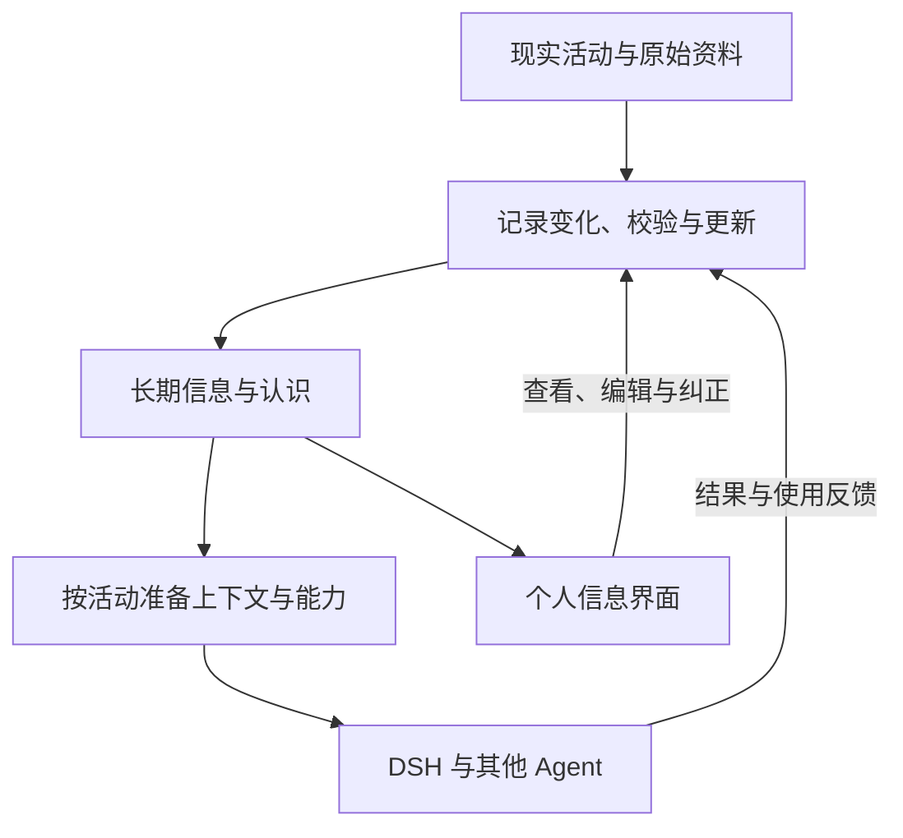

# Personal Context

**由用户掌控的个人信息与长期认知系统。**

Personal Context 希望把关于自己及相关世界的信息，组织成一份可以长期使用、随现实变化更新、能够查看与纠正的资产。它覆盖个人记录、物品与设备、项目、文献、观点和工作经验，让人直接管理这些信息，也让不同 Agent 按当前活动取得所需的上下文、工具和技能。

系统优先在本地保存和组织数据，通过结构化记录保留来源、时间、适用范围与修订关系。原始文件可以继续由合适的应用维护；AI 参与整理与使用，用户保有最终控制权。

本项目采用组合已有能力的方式探索实现。[DeepSeek Harness（DSH）](https://github.com/deepseek-ai/deepseek-harness) 是首个集成方向；[MemOS](https://github.com/MemTensor/MemOS)、现有插件、Skills 与专业应用可以成为系统组成部分。需要补充什么，由完整用户流程中的实际缺口决定。

**当前阶段：系统设计与渐进探索。** 仓库包含系统构想、设计选择、相关工作和开放问题，尚未提供可运行实现。后续可通过集成配置、场景示例和必要的小型扩展逐步展开。

## 从日常信息到长期认识

买过一件设备，之后可能转赠；读过一篇论文，后来可能改变对它的判断；一个项目曾经采用的配置，也可能已经失效。资料长期散落在聊天、文件和应用中，重新使用时还需要知道它描述谁、何时成立、依据什么。

Personal Context 将个人信息管理与 Agent 协作放在同一个循环中：

图中是逻辑职责，各部分可以由现有组件共同承担。

例如，买入设备时保存购买记录与来源；转赠后保留历史，更新当前拥有情况。配置工作环境时，Agent 取得仍在使用的设备信息和适用的方法。若使用了过时记录，用户可以追查依据，修正状态或使用范围，让纠正影响后续活动。

## 设计重点

- **用户长期持有。** 信息可查看、纠正、导出和迁移，用户决定提供给哪个应用或 Agent。
- **保留信息的含义。** 测量、当前状态、作者主张、用户判断和 Skill 各有来源与更新方式。少量共同元数据连接领域结构和原始材料。
- **信息与能力一起准备。** 当前活动决定需要什么资料、工具、Skills 和权限；访问约束覆盖检索及外部模型调用全过程。
- **双向更新。** 现实变化、用户编辑、工具结果和使用反馈持续修订记录与选择规则，人工纠正应持续生效。

这里的“世界模型”指关于用户及其相关世界的一份**外部、局部、带来源与适用条件、能够修订的认识**。系统目标是维护和使用这份认识，具体存储及组件组合保持开放。

## 从已有组件开始

首先核对 DSH 与 MemOS 的兼容版本，体验已有的捕获、检索和查看能力；再选一个物品或设备流程，补充实际需要的对象记录、修正操作或界面入口。具体版本边界见[相关工作](docs/related-work.md)，探索步骤见[架构与集成](docs/architecture.md)。

已有能力可以直接纳入系统。项目的设计价值体现在用户流程、信息语义和组件协作是否连贯；自研范围随实际需要确定。

## 阅读导航

| 文档 | 内容 |
| --- | --- |
| [项目起源](docs/origin.md) | 从个人工具设想到长期信息管理的原始动机 |
| [愿景](docs/vision.md) | 生活、学习与工作中的完整使用体验 |
| [当前设计状态](docs/design-state.md) | 长期原则、当前选择和本轮修订 |
| [架构与集成](docs/architecture.md) | 数据骨架、三个领域例子、读写纠错与 DSH 路线 |
| [相关工作](docs/related-work.md) | 组件能力、固定版本来源与复用边界 |
| [开放问题](docs/open-questions.md) | 尚待判断的问题与可选探索方式 |
| [八月设计笔记](docs/design-notes/2026-08-16-convergence.md) | 保留的历史讨论 |

欢迎通过 Issue 或 PR 讨论场景、设计和小型实现，见[贡献说明](CONTRIBUTING.md)。

## 许可

Copyright © 2026 Starfie1d1272 and contributors.

除另有说明外，本仓库原创设计文档与示意图采用 [CC BY 4.0](LICENSE)。署名可使用“Personal Context — Starfie1d1272”，并链接本仓库、注明修改。第三方引用和依赖适用其原有许可。未来代码加入时单独声明代码许可；当前没有代码许可承诺。
